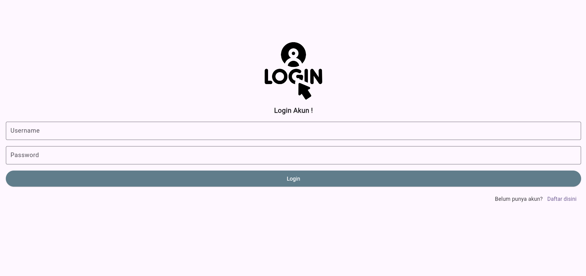
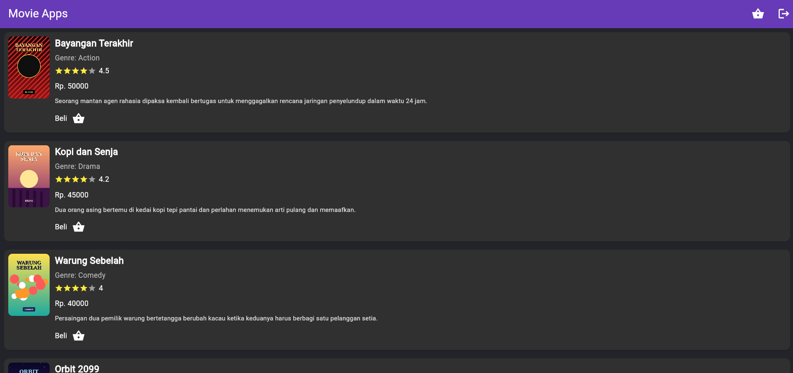
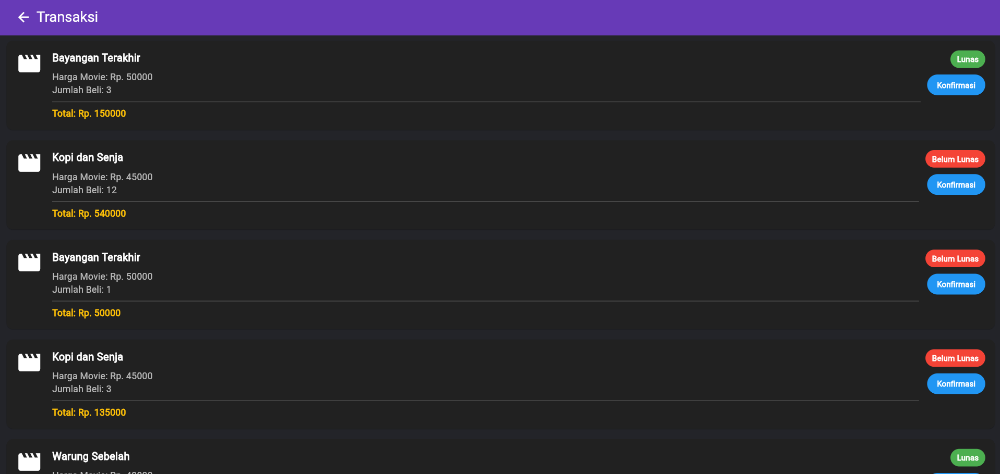
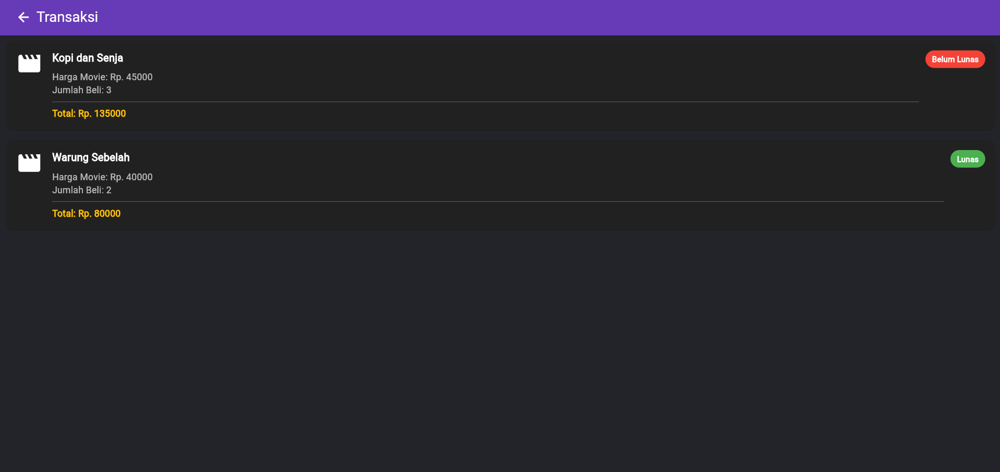
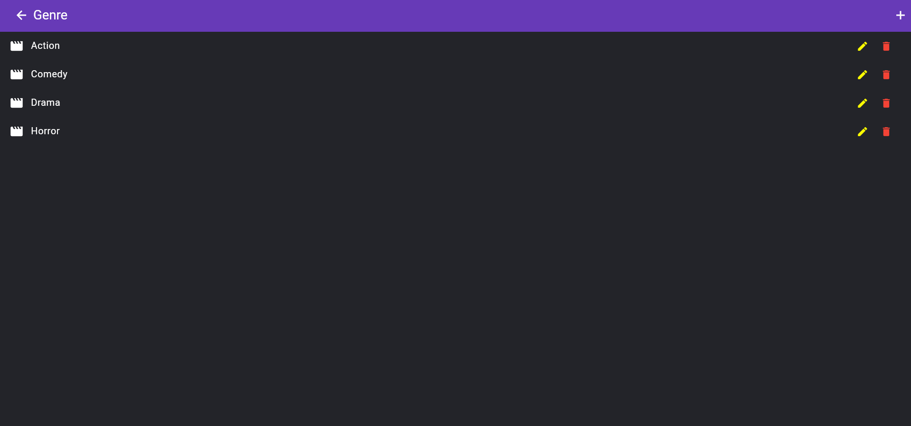
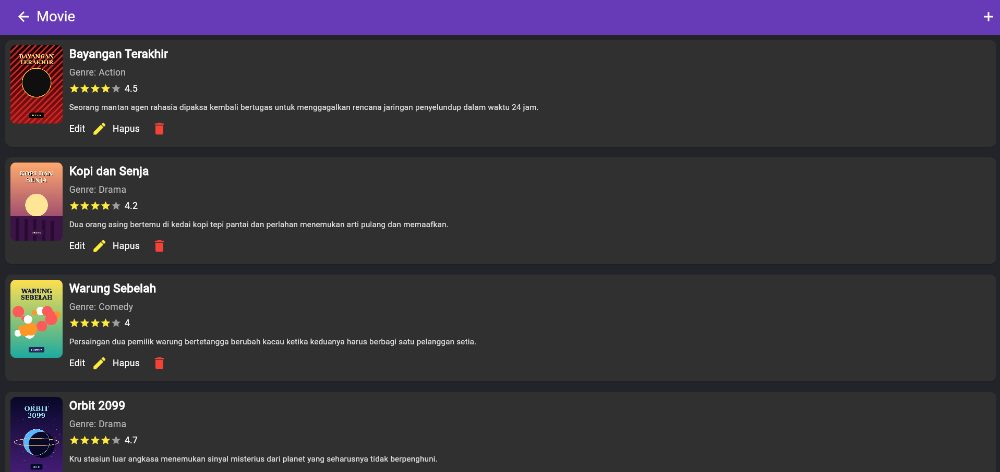

# Movie App (Mobile)

Aplikasi mobile untuk mengelola dan membeli film, dibuat dengan **Flutter**. Aplikasi ini adalah klien mobile dari backend [`movie-rest-api`](https://github.com/esterbln/movie-rest-api): semua data (pengguna, genre, film, transaksi) diambil dan disimpan lewat API tersebut. Versi web dengan fungsi yang sama ada di [`movie-app-frontend`](https://github.com/esterbln/movie-app-frontend).

## Tampilan

| Login | Daftar film |
| --- | --- |
|  |  |
| Transaksi Admin | Transaksi User |
| --- | --- |
|  |  |
| Genre Admin | Movie Admin |
| --- | --- |
|  |  |

## Fitur

**Umum**
- Registrasi dan login pengguna
- Pembagian halaman berdasarkan peran (admin dan user)

**Admin**
- Kelola genre (tambah, ubah, hapus)
- Kelola film (tambah, ubah, hapus) termasuk memilih gambar poster
- Daftar transaksi beserta konfirmasi transaksi

**User**
- Daftar film bergambar poster
- Membeli film
- Riwayat transaksi pribadi

## Teknologi

| Bagian | Yang dipakai |
| --- | --- |
| Framework | Flutter (Dart 3.4 atau lebih baru) |
| Komunikasi ke API | dio |
| Pemilih dropdown | dropdown_search |
| Unggah gambar | image_picker |
| Notifikasi dan dialog | toastification, quickalert |

## Struktur folder

```
lib/
├── api_service/api.dart   # alamat API dan daftar endpoint
├── auth/                  # halaman login dan register
├── admin/                 # beranda admin, genre, film, transaksi
├── users/                 # beranda user, beli film, transaksi
└── main.dart              # titik masuk dan daftar route
assets/                    # gambar yang dipakai aplikasi
```

## Cara menjalankan

Aplikasi ini **membutuhkan backend yang sedang berjalan**, jadi siapkan itu dulu.

1. **Jalankan API.** Ikuti petunjuk di repo [`movie-rest-api`](https://github.com/esterbln/movie-rest-api), sampai server menyala di `http://localhost:3000`. Pastikan MySQL juga menyala.
2. **Pasang Flutter SDK**, lalu unduh atau clone repositori ini dan masuk ke foldernya.
3. **Sesuaikan alamat API** di `lib/api_service/api.dart`, pada baris `baseUrl`:
   - Chrome atau Windows: `http://localhost:3000`
   - Emulator Android: `http://10.0.2.2:3000`
   - HP asli: alamat IP laptop di jaringan Wi-Fi yang sama, misalnya `http://192.168.x.x:3000`
4. **Pasang dependensi:**
   ```
   flutter pub get
   ```
5. **Jalankan aplikasi.** Cara termudah adalah lewat Chrome:
   ```
   flutter run -d chrome
   ```

## Membuat akun

Halaman register hanya membuat akun **user biasa**. Untuk mencoba sebagai admin:

1. Daftar akun seperti biasa lewat halaman register.
2. Di database `pem2-movie`, buka tabel `users`, lalu ubah kolom `role` pada akun itu dari `2` menjadi `1` (misalnya lewat phpMyAdmin).
3. Login ulang, dan halaman admin akan terbuka.

## Urutan mencoba

1. Login sebagai admin, lalu tambah beberapa **genre**.
2. Tambah beberapa **film** (judul, harga, genre, rating, deskripsi, dan poster di bawah 2 MB).
3. Logout, lalu login sebagai user dan **beli** satu film.
4. Login lagi sebagai admin dan **konfirmasi** transaksinya.

## Keterbatasan yang diketahui

Proyek ini adalah latihan kuliah, jadi beberapa hal belum dibuat:

- Alamat API masih ditulis langsung di kode, belum memakai pengaturan lingkungan.
- Belum ada autentikasi berbasis token. Pembagian admin dan user hanya mengikuti data `role` dari respons login.
- Belum ada konfigurasi khusus untuk build rilis Android (misalnya izin internet dan lalu lintas HTTP).
- Belum ada pengujian otomatis.

## Pembuat

Ester Belen Wijaya, mahasiswa S1 Sistem Informasi, Universitas Bandar Lampung.
